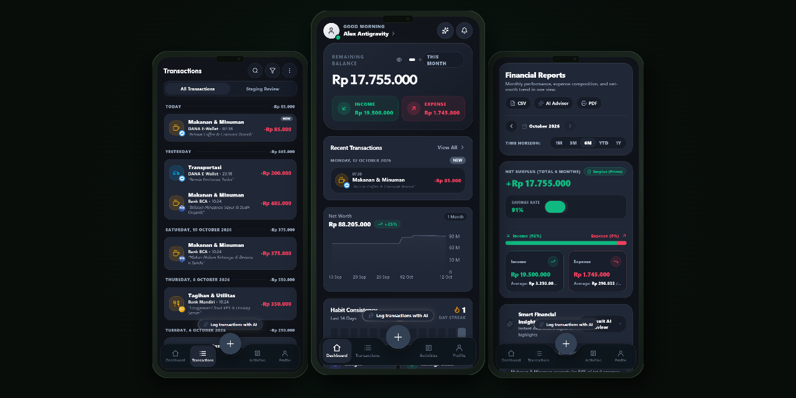
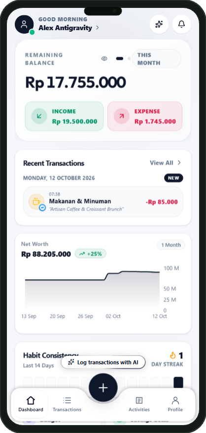
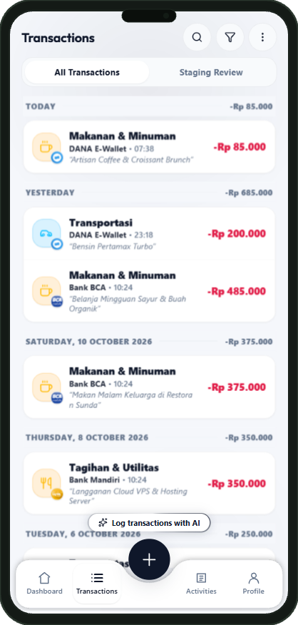
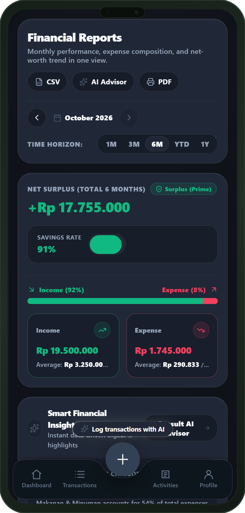
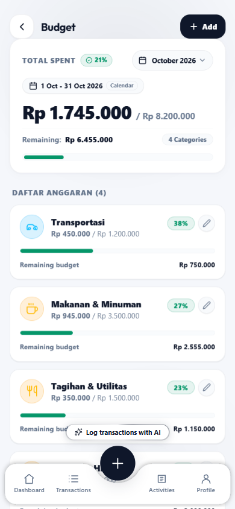
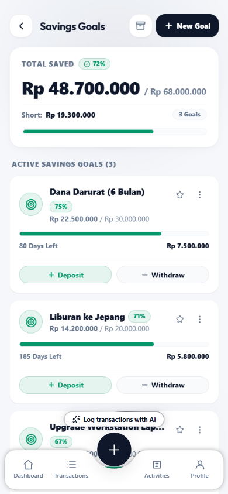
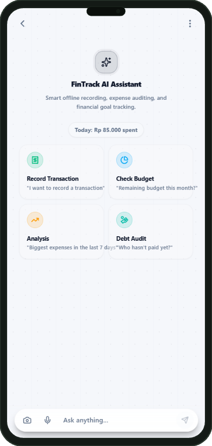
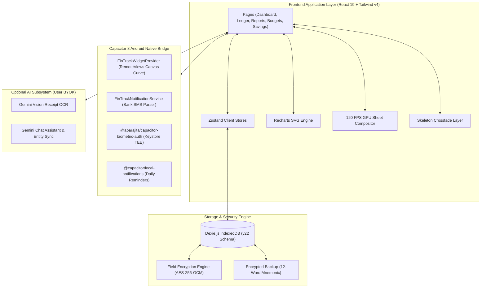

<div align="center">

<br />

<a href="https://github.com/Flynarch/finansial-tracker">
  
</a>

# FinTrack

**The Local-First Financial Operating System for Android.**

Native home screen widgets, intelligent bank SMS ingestion, zero cloud lock-in, and offline-first encrypted storage.

[](https://github.com/Flynarch/finansial-tracker/releases/tag/v6.3.0)
[](https://github.com/Flynarch/finansial-tracker/releases/latest)
[-brightgreen.svg?style=flat-square)](https://github.com/Flynarch/finansial-tracker)
[](SECURITY.md)

[](https://react.dev/)
[](https://vitejs.dev/)
[](https://tailwindcss.com/)
[](https://dexie.org/)
[](SECURITY.md)
[](LICENSE)

<br />

FinTrack gives you complete ownership over your personal finances. Built from the ground up as a native Android application, all accounts, ledgers, and transactions live strictly on your device inside an encrypted offline database. No accounts required, no trackers, and zero forced cloud sync.

[Download Latest APK (v6.3.0)](https://github.com/Flynarch/finansial-tracker/releases/latest) &bull; [Hero Showcase](#hero-showcase) &bull; [App Preview](#app-preview) &bull; [Why FinTrack?](#why-fintrack) &bull; [Key Features](#key-features) &bull; [Architecture](#architecture) &bull; [Getting Started](#getting-started) &bull; [Security](SECURITY.md)

<br />

</div>

## Hero Showcase

<p align="center">
  <a href="https://github.com/Flynarch/finansial-tracker/releases/latest">
    
  </a>
</p>

---

## Table of Contents

- [Hero Showcase](#hero-showcase)
- [App Preview](#app-preview)
- [Why FinTrack?](#why-fintrack)
- [Key Features](#key-features)
  - [1. Frictionless Daily Tracking & In-App Calculator](#1-frictionless-daily-tracking--in-app-calculator)
  - [2. Android Native Power & Home Screen Widgets](#2-android-native-power--home-screen-widgets)
  - [3. Intelligent Ingestion & Notification Sync](#3-intelligent-ingestion--notification-sync)
  - [4. Planning, Savings Vaults & Emergency Runway](#4-planning-savings-vaults--emergency-runway)
  - [5. 120 FPS GPU Ergonomics & Seamless Skeleton Crossfade](#5-120-fps-gpu-ergonomics--seamless-skeleton-crossfade)
  - [6. Zero-Knowledge Privacy & Bring-Your-Own-Key Gemini AI](#6-zero-knowledge-privacy--bring-your-own-key-gemini-ai)
- [Feature Comparison Matrix](#feature-comparison-matrix)
- [System Architecture](#system-architecture)
- [Technology Stack](#technology-stack)
- [Getting Started](#getting-started)
  - [Prerequisites](#prerequisites)
  - [Installation & Local Run](#installation--local-run)
  - [Environment Variables](#environment-variables)
- [Building the Android APK](#building-the-android-apk)
- [Testing & Quality Verification](#testing--quality-verification)
- [Project Structure](#project-structure)
- [License](#license)

---

## App Preview

<p align="center">
  <a href="docs/screenshots/dashboard.png"></a>
  &nbsp;&nbsp;
  <a href="docs/screenshots/transactions.png"></a>
  &nbsp;&nbsp;
  <a href="docs/screenshots/reports.png"></a>
</p>

<p align="center">
  <sub><strong>Interactive Dashboard</strong> &bull; Net worth curve, multi-account carousel, habit discipline heatmap, and quick stats</sub>
  &nbsp;&bull;&nbsp;
  <sub><strong>Daily Transaction Ledger</strong> &bull; Two-tier categories, wallet institution badges, and structured notes</sub>
  &nbsp;&bull;&nbsp;
  <sub><strong>Financial Reports</strong> &bull; 6M net surplus metrics, cash flow ratio, and client-side PDF/CSV exports</sub>
</p>

<br />

<p align="center">
  <a href="docs/screenshots/budget.png"></a>
  &nbsp;&nbsp;
  <a href="docs/screenshots/savings.png"></a>
  &nbsp;&nbsp;
  <a href="docs/screenshots/ai_chat.png"></a>
</p>

<p align="center">
  <sub><strong>Payday-Aligned Budgets</strong> &bull; Category limits, real-time pace meters, and overspend warnings</sub>
  &nbsp;&bull;&nbsp;
  <sub><strong>Savings Goals Vaults</strong> &bull; Target progress rings, deadline projections, and emergency runway calculator</sub>
  &nbsp;&bull;&nbsp;
  <sub><strong>AI Finance Assistant</strong> &bull; Conversational audits, atomic subtask entity sync, and camera receipt OCR</sub>
</p>

---

## Why FinTrack?

Traditional finance apps frequently demand phone numbers, upload private transaction history to commercial cloud servers, and monetize personal data through advertisements or paid subscriptions.

FinTrack is built around four fundamental architectural pillars:

1. **Complete Data Sovereignty (Local-First)**: Your financial data belongs exclusively to you. Every ledger transaction is stored locally using Dexie.js and IndexedDB on your device. The app operates with 100% functionality even in airplane mode.
2. **Android Native Ergonomics**: Engineered specifically for the Android OS ecosystem. Features RemoteViews home screen adaptive widgets (2x2, 4x2, 4x3+), biometric fingerprint unlock via Android Keystore, and responsive haptic feedback.
3. **Accounting & Ledger Invariants**: Enforces strict financial accounting standards including multi-item split transactions, decoupled internal transfers, partial debt repayments, and month-end date stepping.
4. **Hardware-Accelerated 120 FPS Performance**: Touch gestures and bottom sheets bypass React state during movement, applying direct CSS transform compositing for zero-frame-drop interactions on high-refresh-rate displays.

---

## Key Features

### 1. Frictionless Daily Tracking & In-App Calculator
- **Built-in Keypad Calculator**: Enter transaction amounts with an in-app keypad featuring live arithmetic operators (`+`, `-`, `x`, `/`), quick multipliers (`000` / `k`), and instant previews before submission, completely eliminating mobile virtual keyboard layout shifts.
- **Two-Tier Category Hierarchy**: Categorize spending into primary categories and detailed subcategories, each equipped with customizable brand icons and color tokens.
- **Multi-Category Split Transactions**: Divide a single receipt or bill across different categories with individual notes and per-item analytics toggles. Parent-level amounts govern cash balances while child items determine category analytics.
- **Automated Recurring Stepping**: Schedule recurring subscriptions, bills, or paychecks with automated interval stepping that safely handles leap years and month-end dates using start-of-month anchoring.

### 2. Android Native Power & Home Screen Widgets
- **Adaptive Home Screen Widgets**:
  - **Compact (2x2)**: Total net balance, current period label, and quick transaction launch button.
  - **Standard (4x2)**: Net balance alongside real-time income, expense, and surplus/deficit metrics.
  - **Expanded (4x3+)**: Adds an interactive canvas cash flow curve rendered natively via Android RemoteViews.
  - **Privacy Mode**: Tap to mask sensitive balance figures into dots directly on the home screen without opening the app.
- **Deep Links & Quick Actions**: Tap the widget plus icon to instantly trigger transaction entry via `fintrack://quick-add`.
- **Hardware Back Button Orchestration**: Native Android back gesture closes active bottom sheets, modal dialogs, and date pickers in strict LIFO order before navigating backwards or exiting.

### 3. Intelligent Ingestion & Notification Sync
- **Bank & E-Wallet Notification Listener**: Android notification listener bridge detecting incoming receipts from Indonesian banks (BCA, Mandiri, BRI, BNI, Jago) and e-wallets (GoPay, OVO, Dana).
- **In-Flight Synchronization Mutex**: Concurrency lock ensuring app resume events (`visibilitychange` and `appStateChange`) never trigger duplicate database insertions when returning from banking apps.
- **Admin Fee Tolerance**: Automatic correlation for internal top-ups and transfers accommodating standard bank virtual account admin fees up to Rp 2.500.

### 4. Planning, Savings Vaults & Emergency Runway
- **Payday-Aligned Budget Cycles**: Configure custom monthly budgeting start dates (e.g. Starting every 25th) to match your real-world income cycle.
- **Savings Vaults & Emergency Runway**: Allocate money toward specific targets with visual progress rings. Includes an automated Emergency Runway calculator that estimates how many months your savings can cover based on real historical burn rates.
- **Dual Debt & Receivable Ledger (Hutang-Piutang)**: Manage both liabilities (debts you owe) and receivables (loans granted to others), complete with installment schedules and debt forgiveness support.
- **Proportional Bill Splitting**: Calculate group expenses evenly or item-by-item, with proportional distribution of taxes, service fees, and discounts.

### 5. 120 FPS GPU Ergonomics & Seamless Skeleton Crossfade
- **Hardware-Composited Sheet Physics**: Draggable modal sheets and drawers execute touch-drag transformations directly on DOM nodes via `translate3d`, avoiding React re-renders and layout reflows mid-gesture.
- **Seamless Skeleton Crossfade**: Custom `<SkeletonTransition>` component ensures zero OLED black flicker and zero layout pop when transitioning from loading states to loaded content.
- **Stateless Gesture Tracking**: Eliminates upward drag-to-dismiss teleport glitches by managing exit keyframes and inline transitions independently.

### 6. Zero-Knowledge Privacy & Bring-Your-Own-Key Gemini AI
- **Field-Level AES-256-GCM Encryption**: Transaction notes and sensitive details are encrypted at rest using PBKDF2 key derivation and AES-GCM.
- **Encrypted Local Backup**: Export complete database backups secured by a 12-word mnemonic recovery phrase.
- **Zero Third-Party Telemetry**: Zero tracking scripts, zero advertising SDKs, and zero background analytics.
- **Optional Gemini AI (BYOK)**: Connect your personal Google Gemini API key to unlock natural language financial queries, automated receipt OCR extraction from camera photos, and atomic entity mutations.

---

## Feature Comparison Matrix

| Feature | FinTrack | Standard Cloud Apps | Traditional Spreadsheets |
| :--- | :--- | :--- | :--- |
| **Data Sovereignty** | 100% Local Device (IndexedDB) | Remote Cloud Server | Cloud Drive or Local File |
| **Offline Reliability** | Fully Functional (Airplane Mode) | Often Blocked / Degraded | Limited Mobile Usability |
| **Account Creation** | Zero Login Required | Mandatory (Email/Phone) | Requires Cloud Account |
| **Home Screen Widgets** | Android RemoteViews (2x2, 4x2, 4x3+) | Rare or Static Read-Only | None |
| **In-App Calculator** | Built-in Numeric Keypad | Standard OS Keyboard | Formula Cell Typing |
| **Note Encryption** | AES-256-GCM at rest | Plaintext on Server | Plaintext |
| **Bank Notification Sync**| Native Listener with Mutex | Cloud Plaid / Yodlee Sync | Manual Entry |
| **Receipt OCR** | Optional (Personal Gemini Key) | Paid Subscription Paywall | Manual Data Entry |
| **Advertisements & Trackers**| Zero Ads, Zero Trackers | Common Advertisements | None |

---

## System Architecture



---

## Technology Stack

| Layer | Technology | Version | Purpose |
| :--- | :--- | :--- | :--- |
| **UI Framework** | React | 19.2.5 | Component-driven declarative mobile interface |
| **Bundler & Tooling**| Vite | 8.0.10 | High-speed development server and production bundler |
| **Styling** | Tailwind CSS | 4.2.4 | CSS tokens, fluid dark/light theming, and responsive layouts |
| **Native Runtime** | Capacitor | 8.4.1 | Android native bridge, plugin ecosystem, and lifecycle events |
| **Local Database** | Dexie.js | 4.4.2 | IndexedDB wrapper with reactive queries (`useLiveQuery`) |
| **Client State** | Zustand | 5.0.13 | High-performance decoupled client state stores |
| **Visual Charts** | Recharts | 3.9.2 | Responsive SVG chart visualizations |
| **Biometric Auth** | @aparajita/capacitor-biometric-auth | 10.0.0 | Android Keystore fingerprint and biometric unlock |
| **Math Precision** | decimal.js-light | 2.5.1 | Arbitrary precision arithmetic preventing floating point drift |
| **Date Management** | date-fns | 4.1.0 | Immutable date mathematics and localization |
| **PDF Generation** | jsPDF | 4.2.1 | In-memory client-side PDF document generation |
| **Icons** | Lucide React | 1.25.0 | Clean, accessible SVG iconography |

---

## Getting Started

### Prerequisites
- **Node.js**: `v20.x` or higher
- **npm**: `v9.x` or higher
- **Android Studio** & **Java JDK 17 / 21** (only required if building the native Android APK from source)

### Installation & Local Run

1. Clone the repository:
   ```bash
   git clone https://github.com/Flynarch/finansial-tracker.git
   cd finansial-tracker
   ```

2. Install dependencies:
   ```bash
   npm install
   ```

3. Start the local development server:
   ```bash
   npm run dev
   ```

Open your browser at `http://localhost:5173`.

### Environment Variables

Environment variables are entirely optional. If you wish to set development defaults, create a `.env` file in the project root:

```env
# Optional Google Gemini fallback for development
VITE_GEMINI_API_KEY=your_gemini_api_key

# Optional Firebase configuration for cloud backup testing
VITE_FIREBASE_API_KEY=your_firebase_api_key
VITE_FIREBASE_AUTH_DOMAIN=your_project.firebaseapp.com
VITE_FIREBASE_PROJECT_ID=your_project_id
VITE_FIREBASE_STORAGE_BUCKET=your_project.appspot.com
VITE_FIREBASE_MESSAGING_SENDER_ID=your_sender_id
VITE_FIREBASE_APP_ID=your_app_id
```

---

## Building the Android APK

1. Build production web assets and sync to the native Android directory:
   ```bash
   npm run build
   npx cap sync android
   ```

2. Assemble the Android APK with Gradle:
   - **Windows PowerShell / CMD**:
     ```powershell
     cmd.exe /c "cd android && gradlew.bat assembleDebug"
     ```
   - **Linux / macOS**:
     ```bash
     cd android && ./gradlew assembleDebug
     ```

The compiled binary will be generated at `android/app/build/outputs/apk/debug/app-debug.apk`.

---

## Testing & Quality Verification

FinTrack enforces strict verification standards across all code changes:

```bash
# Run unit and regression test suite (1,748+ tests across 120 suites)
npm test

# Run ESLint validation
npm run lint

# Audit for unlocalized or hardcoded UI strings
npm run lint:i18n

# Validate production build bundle
npm run build

# Verify Android Java compilation
cmd.exe /c "cd android && gradlew.bat compileDebugJavaWithJavac"
```

---

## Project Structure

```
finansial-tracker/
├── android/                  # Native Android Capacitor project
│   └── app/src/main/
│       ├── java/com/fintrack/app/
│       │   ├── FinTrackWidgetProvider.java       # Home screen widget logic & canvas curve rendering
│       │   ├── FinTrackWidgetConfigActivity.java # Widget configuration activity
│       │   ├── FinTrackNotificationPlugin.java   # Native notification ingestion bridge
│       │   └── MainActivity.java                 # Android entry activity
│       └── res/                                  # Widget XML layouts, drawables, and themes
├── docs/                     # Documentation assets and screenshots
│   ├── assets/               # Brand logos and flagship hero showcase banner
│   └── screenshots/          # Ultra-HD 2x device mockups
├── src/
│   ├── components/           # Domain-driven UI components
│   │   ├── budget/           # Budget cycle limits, warnings, and alerts
│   │   ├── chat/             # AI finance chat and receipt OCR views
│   │   ├── dashboard/        # Net worth cards, account carousel, and stat charts
│   │   ├── habits/           # Discipline heatmaps and habit trackers
│   │   ├── layout/           # AppShell, bottom navigation, and mobile header
│   │   ├── loans/            # Debt and receivable ledgers (Hutang-Piutang)
│   │   ├── reports/          # Financial statements and category breakdowns
│   │   ├── savings/          # Savings goal vaults and emergency runway
│   │   ├── settings/         # Security preferences, biometrics, and backups
│   │   ├── split-bill/       # Multi-participant bill splitting dialogs
│   │   ├── transactions/     # Transaction cards, custom keypad, and filter drawers
│   │   └── ui/               # Reusable primitives (Buttons, Sheets, Modals, SkeletonTransition)
│   ├── hooks/                # Custom React hooks (useDashboardData, useBackButton, etc.)
│   ├── lib/                  # Offline database, encryption, currency, and AI services
│   ├── locales/              # Bilingual dictionaries (id.js, en.js)
│   ├── pages/                # Main router views (Dashboard, Transactions, Reports, etc.)
│   ├── store/                # Zustand application stores
│   ├── App.jsx               # Application root and route configuration
│   ├── index.css             # Tailwind CSS tokens and base styles
│   └── main.jsx              # React bootstrap entry
├── tests/                    # Vitest unit and integration test suites
├── capacitor.config.json     # Capacitor configuration
├── package.json              # Project dependencies and npm scripts
└── vite.config.js            # Vite bundler configuration
```

---

## License

This project is open-source and licensed under the [MIT License](LICENSE).
